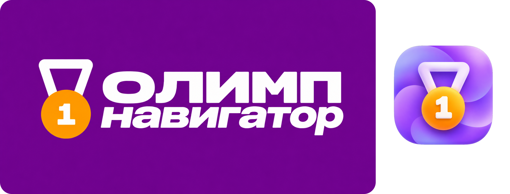

# ОлимпНавигатор


Бот для школьников в MAX. Помогает находить олимпиады, конкурсы и хакатоны, следить за сроками и собирать достижения в портфолио.

В боте есть поиск по предмету и типу мероприятия, избранное, напоминания, карточки со ссылками на сайты организаторов, профиль, портфолио и рейтинг по подтверждённым результатам. На вопросы об олимпиадах отвечает GigaChat. Если ИИ недоступен, бот показывает подходящие ссылки из каталога.

## Что понадобится

- Docker для запуска в контейнере или Python 3.12+ для запуска из терминала.
- Токен бота MAX.
- Authorization Key GigaChat для ответов ИИ. Без него остальные разделы работают.

Токен MAX получают после создания бота по [инструкции платформы](https://dev.max.ru/docs/chatbots/bots-coding/prepare/). Ключ GigaChat получают в [кабинете разработчика](https://developers.sber.ru/docs/ru/gigachat/individuals-quickstart/). Файлы `.env` и `max_token.py` с ключами не публикуйте.

Python-библиотеки из `requirements.txt`:

| Библиотека | Версия | Для чего используется |
| --- | --- | --- |
| `aiohttp` | 3.12.15 | Запросы к MAX и GigaChat, работа вебхука. |
| `beautifulsoup4` | 4.15.0 | Разбор страниц с олимпиадами и конкурсами. |
| `requests` | 2.34.2 | Загрузка страниц для каталога. |

При сборке Docker эти библиотеки устанавливаются автоматически. Для запуска без Docker их нужно установить командой из раздела «Запуск из командной строки».

## Запуск через Docker

В корне проекта создайте файл с настройками. В macOS и Linux:

```bash
cp .env.example .env
```

В Windows PowerShell:

```powershell
Copy-Item .env.example .env
```

Откройте `.env` и укажите `MAX_BOT_TOKEN`. Для ИИ заполните `GIGACHAT_AUTH_KEY`. 

Соберите образ и запустите контейнер в macOS или Linux:

```bash
docker build -t olimpnavigator-max .
mkdir -p data
docker run --rm --name olimpnavigator-max --env-file .env -p 8080:8080 -v "$(pwd)/data:/app/data" olimpnavigator-max
```

В Windows PowerShell:

```powershell
docker build -t olimpnavigator-max .
New-Item -ItemType Directory -Force data | Out-Null
docker run --rm --name olimpnavigator-max --env-file .env -p 8080:8080 -v "${PWD}\data:/app/data" olimpnavigator-max
```

Бот работает, пока запущен контейнер. Остановить его можно сочетанием `Ctrl+C`. Каталог, профили и достижения хранятся в папке `data`, поэтому после нового запуска они сохранятся.

Без `MAX_WEBHOOK_URL` бот получает события через Long Polling - этого достаточно для локальной проверки. Для постоянного размещения укажите публичный HTTPS-адрес с путём `/max-webhook` и направьте запросы с порта 443 на порт 8080 контейнера.

При запуске с Docker Compose:

```bash
docker compose up --build -d
docker compose logs -f bot
```

Для остановки выполните `docker compose down`.

## Запуск из командной строки

Создайте в корне проекта файл `max_token.py`:

```python
MAX_BOT_TOKEN = "токен_бота_MAX"
GIGACHAT_AUTH_KEY = "ключ_GigaChat_или_пустая_строка"
```

Если ключа GigaChat нет, задайте `GIGACHAT_AUTH_KEY = ""`. Команда `pip install -r requirements.txt` установит библиотеки в версиях, указанных в файле. В macOS и Linux запустите бота так:

```bash
python3 -m pip install -r requirements.txt
python3 main.py
```

В Windows PowerShell используйте Python Launcher:

```powershell
py -3 -m pip install -r requirements.txt
py -3 main.py
```

## Проверка работы

Откройте бота в MAX и отправьте `/start`. После выбора возраста, класса, региона и интересов откроются основные разделы. В «Мероприятиях» можно открыть карточку и добавить событие в избранное; в «Поиске» - применить фильтры; в «Портфолио» - отправить результат на проверку. Диалог с GigaChat доступен при заданном ключе API.


## Настройки

| Переменная | Для чего нужна |
| --- | --- |
| `MAX_BOT_TOKEN` | Токен бота MAX. Обязателен для запуска. |
| `GIGACHAT_AUTH_KEY` | Ключ GigaChat. Нужен для ответов ИИ. |
| `GIGACHAT_SCOPE` | Тип доступа GigaChat. Для личного аккаунта - `GIGACHAT_API_PERS`. |
| `GIGACHAT_MODEL` | Модель GigaChat. По умолчанию - `GigaChat-2`. |
| `MAX_ADMIN_IDS` | ID администраторов через запятую. Нужны для проверки достижений. |
| `OLIMPNAV_TIMEZONE` | Часовой пояс для сроков и напоминаний. |
| `MAX_WEBHOOK_URL` | Публичный HTTPS-адрес вебхука. Необязателен для первого запуска. |
| `MAX_WEBHOOK_SECRET` | Секрет для вебхука. Нужен вместе с `MAX_WEBHOOK_URL`. |

Свой MAX ID администратор может узнать, отправив боту `/myid`. После добавления ID в настройки перезапустите бота. Чтобы получать заявки на проверку достижений, администратору нужно сначала открыть диалог с ботом.

Проект подготовлен для [хакатона «Идея Фикс»](https://www.sferum.ru/hackathon_2026).
